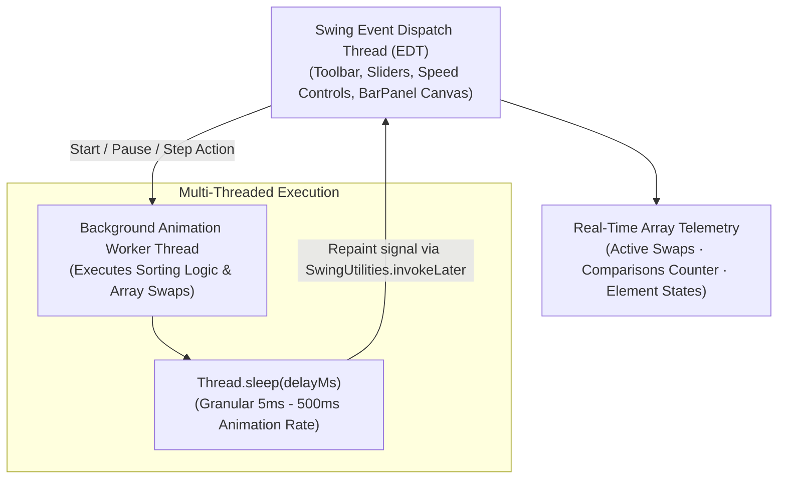

# Java DSA Visualizer — Real-Time Algorithm Animation Suite

> **Source Repository:** [github.com/Pradeep-B28/JAVA-Searching-Sorting-Visualizer](https://github.com/Pradeep-B28/JAVA-Searching-Sorting-Visualizer)  
> **Author:** [B Pradeep](https://github.com/Pradeep-B28) · [Portfolio](https://pradeep-b28.github.io/Pradeep-B28/)

---

## Overview

**Java DSA Visualizer** is a high-performance desktop animation tool engineered in pure Java with Swing and `Graphics2D`. It visualizes the internal mechanics of searching and sorting algorithms—including in-place partitioning in QuickSort, auxiliary array merging in MergeSort, max-heap sift-downs in HeapSort, and binary search interval halving—frame-by-frame with real-time operational telemetry.



---

## Supported Algorithms & Complexity Reference

| Algorithm | Category | Best Case | Average Case | Worst Case | Space | Visual Color Indicators |
| :--- | :--- | :--- | :--- | :--- | :--- | :--- |
| **Bubble Sort** | Comparison Sort | $\mathcal{O}(N)$ | $\mathcal{O}(N^2)$ | $\mathcal{O}(N^2)$ | $\mathcal{O}(1)$ | Red: Comparing adjacent · Green: Sorted element |
| **Selection Sort** | Selection Sort | $\mathcal{O}(N^2)$ | $\mathcal{O}(N^2)$ | $\mathcal{O}(N^2)$ | $\mathcal{O}(1)$ | Yellow: Minimum found · Blue: Active scan pointer |
| **Insertion Sort** | Insertion Sort | $\mathcal{O}(N)$ | $\mathcal{O}(N^2)$ | $\mathcal{O}(N^2)$ | $\mathcal{O}(1)$ | Purple: Shifting key · Green: Sorted prefix |
| **Merge Sort** | Divide & Conquer | $\mathcal{O}(N \log N)$ | $\mathcal{O}(N \log N)$ | $\mathcal{O}(N \log N)$ | $\mathcal{O}(N)$ | Orange: Subarray boundary · Green: Merged items |
| **Quick Sort** | Divide & Conquer | $\mathcal{O}(N \log N)$ | $\mathcal{O}(N \log N)$ | $\mathcal{O}(N^2)$ | $\mathcal{O}(\log N)$ | Blue: Active pivot · Red: Left/Right pointers |
| **Heap Sort** | Selection Sort | $\mathcal{O}(N \log N)$ | $\mathcal{O}(N \log N)$ | $\mathcal{O}(N \log N)$ | $\mathcal{O}(1)$ | Yellow: Sift-down swap · Green: Extracted root |
| **Binary Search** | Searching | $\mathcal{O}(1)$ | $\mathcal{O}(\log N)$ | $\mathcal{O}(\log N)$ | $\mathcal{O}(1)$ | Purple: Midpoint · Gray: Eliminated bounds · Green: Target |
| **Linear Search** | Searching | $\mathcal{O}(1)$ | $\mathcal{O}(N)$ | $\mathcal{O}(N)$ | $\mathcal{O}(1)$ | Blue: Scan index · Green: Target found |

---

## Key Features & Controls

1. **Multi-Threaded Responsiveness:**
   - Decouples the Swing Event Dispatch Thread (EDT) from algorithm computation. Long-running computational sorts never freeze or stutter window resizing or user inputs.
2. **Granular Playback Controls:**
   - Full Run, Pause, Single-Step Forward, and Reset controls.
3. **Dataset Generators:**
   - **Uniform Random:** Standard distribution across dataset sizes (10 to 200 bars).
   - **Nearly Sorted:** Simulates realistic pre-sorted data.
   - **Reversed Order:** Triggers worst-case asymptotic behaviors.
   - **High Duplicates:** Validates stability with duplicate keys.
4. **Live Telemetry:**
   - Real-time counters showing exact comparison and swap totals.

---

## Compilation & Quick Start

### Prerequisites
- JDK 17 or higher
- Windows, macOS, or Linux desktop environment

### Build & Run
```powershell
# 1. Clone the repository
git clone https://github.com/Pradeep-B28/JAVA-Searching-Sorting-Visualizer.git
cd JAVA-Searching-Sorting-Visualizer

# 2. Compile Java source files to out/ directory
javac -d out src/main/java/com/pradeep/dsaviz/*.java

# 3. Launch the desktop visualizer
java -cp out com.pradeep.dsaviz.DSAVisualizerApp
```

---

## License

This project is licensed under the [MIT License](LICENSE).
